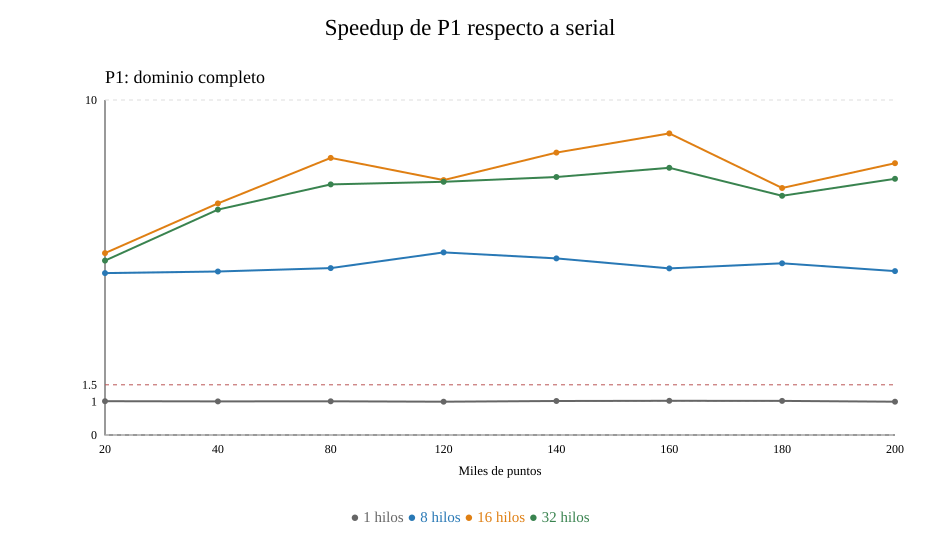
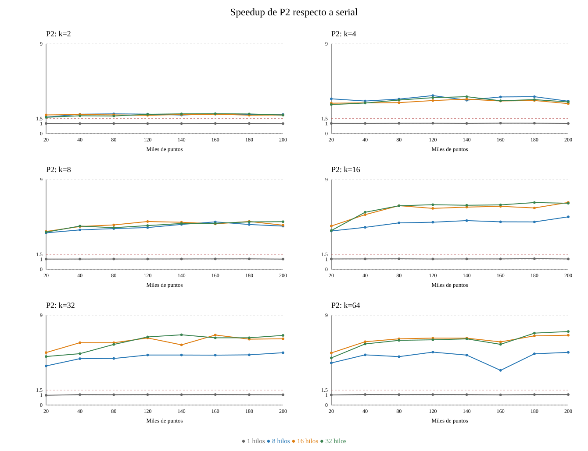

# Informe: DBSCAN paralelo para detectar ruido

## 1. Problema y algoritmo

La presentación pide clasificar puntos en dos pasos, sin construir identificadores de clúster. Con `epsilon = 0.03` y `min_samples = 10`, un punto es **core de primer orden** cuando tiene al menos diez puntos, contando el propio, a distancia menor o igual a `epsilon`. En el segundo paso, un punto que no era core pasa a **core de segundo orden** si está a distancia `epsilon` de algún core del primer paso. Si no cumple ninguna condición, es **ruido**. El segundo paso consulta solo los cores encontrados en el primero; no se propaga desde puntos recién convertidos.

La salida es un CSV `x,y,etiqueta`, sin encabezado. Los dos tipos de core se escriben con `1` y el ruido con `0`, igual que en la libreta de referencia. El programa conserva la distinción internamente y la muestra en sus conteos de salida estándar y en los archivos experimentales.

## 2. Código y estrategias de paralelización

Las implementaciones están en `dbscan_serial.cpp`, `dbscan_p1.cpp` y `dbscan_p2.cpp`. Cada archivo contiene lo necesario para compilar su versión por separado; las funciones comunes se repiten para mantener esa independencia. `leer_csv` carga las coordenadas. `construir_indice` coloca cada punto en una celda cuadrada de lado `epsilon`. Para buscar vecinos basta recorrer la celda del punto y las ocho celdas que la rodean: un punto más lejano en la cuadrícula no puede estar a distancia `epsilon`. Se usa `std::hypot` para calcular la distancia sin desbordamiento al elevar números muy grandes al cuadrado. El conteo de vecinos se detiene al llegar a `min_samples`, pues después ya sabemos que el punto es core. No se guarda una matriz completa de distancias; con 200,000 puntos esa matriz necesitaría mucha más memoria que el equipo disponible.

Para explicar el programa en una exposición, las funciones tienen este orden lógico:

| Función | Papel |
|---|---|
| `leer_csv` | Lee los puntos del archivo de entrada. |
| `clave_celda`, `construir_indice` | Preparan las celdas y sus vecinas. |
| `es_core` | Hace el primer paso: cuenta vecinos hasta alcanzar el mínimo. |
| `alcanza_core` | Hace el segundo paso: busca un core original cercano. |
| `dividir_espacio` | Asigna cada punto a uno de los `k` rectángulos de P2; está solo en `dbscan_p2.cpp`. |
| `clasificar` | Ejecuta ambos pasos con la estrategia del archivo que se compiló. |
| `resumen`, `escribir_csv` | Comprueban y guardan el resultado. |

Las tres versiones aplican exactamente los mismos criterios mediante `es_core` y `alcanza_core`:

| Versión | Cómo reparte el trabajo |
|---|---|
| Serial | Recorre todos los puntos en cada paso con bucles normales. |
| P1 | Conserva el dominio completo y distribuye sus puntos entre hilos con dos bucles `parallel for` de OpenMP. |
| P2 | Divide el plano en `k` rectángulos; cada rectángulo posee sus puntos y los hilos procesan rectángulos con `parallel for`. |

P2 usa una malla de `2×1`, `2×2`, `4×2`, `4×4`, `8×4` y `8×8` rectángulos para `k = 2, 4, 8, 16, 32, 64`, respectivamente. Los primeros dos casos reproducen los cortes dibujados en la presentación. Un punto se asigna a un único rectángulo y su etiqueta se guarda en su posición original. Para evitar errores de frontera, todas las regiones consultan el mismo índice espacial de **solo lectura**, que incluye puntos del otro lado de cualquier corte. Así, los vecinos que forman el halo de una región también cuentan. Las dos pasadas de OpenMP están separadas por una barrera implícita: el segundo paso empieza solo cuando todos los cores de primer orden están decididos. Cada hilo escribe posiciones diferentes, por lo que no hay conflicto al reunir los resultados.

## 3. Evaluación experimental

### Diseño

`experimentos.py` genera con semilla 11 puntos aleatorios reproducibles: cuatro grupos gaussianos de desviación 0.06, un 1 % de puntos uniformes y coordenadas redondeadas a tres decimales. Los ocho CSV contienen los primeros `N` puntos de una misma serie; esto permite comparar tamaños manteniendo el mismo patrón. También se pueden usar directamente los CSV de dos columnas generados por la libreta original.

Se evaluaron todos los tamaños solicitados: `N = 20,000, 40,000, 80,000, 120,000, 140,000, 160,000, 180,000, 200,000`. El equipo tiene 16 procesadores lógicos, así que se usaron `1, 8, 16, 32` hilos. Para P2 se probaron todos los `k = 2, 4, 8, 16, 32, 64`. Se midieron diez repeticiones para cada configuración: 80 seriales, 320 de P1 y 1,920 de P2, es decir, **2,320 tiempos crudos**. P1 y serial no dependen de `k`, por lo que se midieron una sola vez para cada combinación aplicable, sin duplicar mediciones idénticas.

El cronómetro de C++ (`steady_clock`) mide las dos pasadas de clasificación. La lectura de CSV, construcción del índice, división espacial y escritura del resultado ocurren fuera del cronómetro. Esto aísla el cálculo que se paraleliza y evita que la lectura del disco o la preparación común dominen tiempos de pocos milisegundos. Por ello, los speedups informados son **del cálculo de clasificación**, no del tiempo total desde que se abre el programa. Todas las configuraciones usan el mismo `epsilon`, `min_samples`, datos e índice. Cada configuración se ejecutó de manera secuencial respecto de las otras, aunque sus hilos trabajan en paralelo.

Si se ejecuta una sola vez desde la terminal y se incluye la escritura del CSV, el beneficio total puede ser menor porque esa parte no está paralelizada. Por eso no se debe presentar el speedup del cálculo como si fuese el del programa completo.

El tiempo representativo es la media de sus diez repeticiones. Para un mismo `N`, el speedup se calculó como `media_serial / media_paralela`. `resultados/tiempos_crudos.csv` contiene cada tiempo y el resumen de sus etiquetas; `resultados/resumen.csv` contiene media, desviación y speedup. Las gráficas SVG se construyeron directamente desde ese resumen.

**Procedencia de los archivos incluidos:** los números, CSV y gráficas de este informe corresponden a ejecuciones anteriores a la separación del código en tres archivos. Se conservaron sin modificar para no presentar una reorganización como si fuera una nueva medición. `experimentos.py` usa ahora los tres ejecutables independientes con el mismo procedimiento y cronómetro. Al ejecutar `python3 experimentos.py medir` se obtendrá una corrida nueva que reemplazará esos resultados.

### Equipo

Las mediciones se hicieron en un Intel Core i5-14450HX, con 10 núcleos físicos, 16 procesadores lógicos, 20 MiB de caché L3 y 15 GiB de RAM. Sistema: Bazzite 44.20261012.0, kernel Linux 7.2.9-ogc3.1.fc44.x86_64. Se usó GCC 16.2.1 con `-O2 -std=c++17 -fopenmp` y Python 3.14.8. OpenMP fue proporcionado por `libgomp`. La memoria libre, la temperatura, la frecuencia y otros procesos pueden variar durante las mediciones, especialmente cuando el cálculo dura menos de un milisegundo.

### Resultados

La tabla presenta la media en milisegundos y el speedup de P1 con 16 hilos y P2 con `k=64` y 16 hilos. Los 232 casos completos, incluidos los demás valores de `k` e hilos, están en `resultados/resumen.csv`.

| Puntos | Serial (ms) | P1 16 hilos (ms) | Speedup P1 | P2 k=64, 16 hilos (ms) | Speedup P2 |
|---:|---:|---:|---:|---:|---:|
| 20,000 | 2.503 | 0.461 | 5.43 | 0.479 | 5.22 |
| 40,000 | 4.865 | 0.704 | 6.91 | 0.766 | 6.35 |
| 80,000 | 9.534 | 1.153 | 8.27 | 1.436 | 6.64 |
| 120,000 | 14.180 | 1.863 | 7.61 | 2.113 | 6.71 |
| 140,000 | 16.521 | 1.960 | 8.43 | 2.465 | 6.70 |
| 160,000 | 19.078 | 2.119 | 9.00 | 3.014 | 6.33 |
| 180,000 | 21.363 | 2.897 | 7.37 | 3.079 | 6.94 |
| 200,000 | 23.244 | 2.865 | 8.11 | 3.321 | 7.00 |

P1 superó el requisito de speedup mayor que 1.5; su mayor valor medido fue **9.00** con 160,000 puntos y 16 hilos. P2 también lo superó; llegó a **7.37** con 200,000 puntos, `k=64` y 32 hilos. Con 200,000 puntos y 16 hilos, P1 dio 8.11 y P2 con `k=64` dio 7.00.

La diferencia principal entre P1 y P2 viene de cuántas regiones pueden trabajar a la vez. En P2 con `k=2`, solo hay dos regiones: aunque se pidan 16 hilos, como máximo dos reciben trabajo. Por eso su speedup medio con 16 hilos fue 1.88. Al aumentar `k`, hay más tareas; con `k=64`, el speedup medio con 16 hilos fue 6.49. P1 reparte puntos directamente y no tiene este límite de `k`, de modo que en esta evaluación fue generalmente más rápida. P2 se acercó cuando tuvo suficientes regiones, pero el reparto entre rectángulos y su planificación añadieron costos. En P1, la media de speedup con 32 hilos fue 7.18 frente a 7.64 con 16 hilos; pedir más hilos que los 16 procesadores lógicos no aportó una mejora general. Como las ejecuciones son cortas, diferencias pequeñas deben interpretarse con cautela.

## 4. Comprobación de resultados

`python3 experimentos.py verificar` compara una solución directa que revisa todos los pares de un conjunto pequeño con serial, P1 y P2. Los 22 casos cubren hilos distintos, los seis valores de `k`, puntos repetidos y puntos cerca de fronteras. La verificación comprueba las categorías internas, el hash y el CSV binario. Además, durante la evaluación completa se compararon los conteos y el hash de **cada una de las 2,320 ejecuciones** con la versión serial del mismo tamaño; todas coincidieron. Con 200,000 puntos se obtuvieron 199,269 cores de primer orden, 390 de segundo orden y 341 ruidos, sin diferencias entre versiones.

## 5. Uso responsable y ético de IA generativa

Se utilizó **OpenAI Codex (GPT-6)** como apoyo para revisar la presentación, redactar una primera versión del código y de este informe, preparar el experimento y ayudar a analizar los resultados. El código se compiló y los resultados se comprobaron con una referencia independiente y con comparaciones entre versiones. Los números de las tablas y gráficas proceden de los CSV medidos; no se inventaron mediciones. Antes de entregar o exponer el trabajo, sus autores deben revisar personalmente cada función, ejecutar las pruebas y poder explicar las decisiones y límites del experimento. La responsabilidad final del contenido corresponde a quienes lo entreguen.

Esta declaración sigue el principio de transparencia, supervisión humana y no fabricación de resultados de las guías [IEEE RAS sobre uso de IA generativa](https://www.ieee-ras.org/publications/guidelines-for-generative-ai-usage/) y [Elsevier sobre IA generativa](https://www.elsevier.com/about/policies-and-standards/generative-ai-policies-for-journals) citadas en la presentación.
